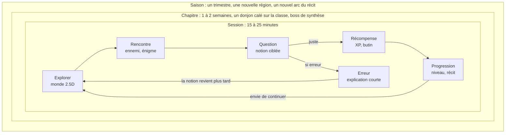

# PRD – Jeu éducatif 2.5D « Les Chroniques d'Aldoria » (titre provisoire)

10 octobre 2026 · Eric

## 1. Résumé et vision

Un jeu d'aventure 2.5D jouable dans le navigateur, sur le PC familial et la tablette Android, où chaque combat, énigme ou dialogue repose sur une notion du programme scolaire, calibrée sur le niveau du joueur : 6ème pour Jules, seconde générale pour Tom.

**Vision** : que les enfants lancent le jeu pour l'aventure, et qu'ils révisent sans s'en rendre compte. La pédagogie est le moteur caché, le jeu est la façade.

**Principes directeurs**

- **Le savoir est un pouvoir** : une bonne réponse déclenche une action de jeu (sort, ouverture de porte, craft), jamais un simple "Bravo".
- **Deux mondes, un même moteur** : chaque enfant a son propre monde, son récit et son ton ; le moteur pédagogique, les mécaniques et l'éditeur parent sont communs.
- **Session courte, envie de revenir** : 15 à 25 minutes suffisent pour progresser, avec un fil narratif qui donne envie de connaître la suite.
- **Zéro punition** : l'erreur coûte un peu de ressources, jamais la progression ; elle déclenche une explication.
- **Le parent pilote** : Eric choisit les chapitres travaillés en classe et suit les acquis.

**Hors périmètre** : jeu commercial, multijoueur en ligne ouvert, publicité, achats intégrés, collecte de données hors du foyer, récompenses réelles (temps d'écran, argent, sorties).

## 2. Contexte, problème et objectifs

Le jeu doit transformer la révision, aujourd'hui subie, en un moment choisi, avec un effet mesurable sur les notions vues en classe.

**Constat de départ**

- Les révisions classiques (fiches, exercices du manuel) sont perçues comme une corvée.
- Les applications éducatives grand public sont soit trop enfantines pour un lycéen, soit déconnectées du programme exact suivi en classe.
- Les jeux vidéo du commerce captent l'attention mais n'apportent rien au programme.

**Objectifs**

| Objectif | Indicateur | Cible |
| --- | --- | --- |
| Envie de jouer | Sessions lancées sans sollicitation parentale | 3 par semaine et par enfant |
| Régularité | Semaines consécutives avec au moins 2 sessions | 6 semaines d'affilée |
| Révision effective | Questions répondues par session | 20 à 40 |
| Apprentissage | Taux de réussite d'une notion entre la 1ère et la 4ème exposition | +25 points |
| Alignement scolaire | Part des questions liées au chapitre en cours en classe | 50 % minimum |
| Plaisir | Note donnée par l'enfant en fin de chapitre (1 à 5) | 4 ou plus |

Ces cibles sont des hypothèses de départ à ajuster après un mois de test réel.

## 3. Personas

Trois utilisateurs aux attentes très différentes : un collégien qui veut de l'aventure, un lycéen qui refuse tout ce qui fait "jeu pour petits", et un parent qui veut du contrôle sans friction.

| | Jules | Tom | Eric (parent admin) |
| --- | --- | --- | --- |
| Âge, niveau | 11 ans, 6ème (cycle 3) | 15 ans, seconde générale | Parent, administrateur IT |
| Ce qui le motive | Explorer, collectionner, personnaliser son héros, compagnon animal | Défi, progression visible, liberté de build, humour, histoire plus sombre | Voir les enfants réviser sans conflit, savoir ce qui est acquis |
| Ce qui le fait décrocher | Textes longs, échecs répétés, interface complexe | Ton infantilisant, questions trop faciles, répétition visible | Saisie de contenu fastidieuse, données exposées hors du foyer |
| Format de questions | QCM illustré, glisser-déposer, calcul court, lecture de carte | Calcul en plusieurs étapes, réponse libre numérique, analyse de document, justification | Éditeur de banques de questions, import CSV/JSON |
| Durée de session | 15 à 20 min | 20 à 30 min | 5 min par semaine |
| Support | PC familial et tablette Android (navigateur) | PC familial et tablette Android (navigateur) | PC |

**Conséquence de design** : deux mondes distincts, construits sur le même moteur. Pour Jules, un ton lumineux et un compagnon guide. Pour Tom, une interface plus épurée, un récit plus mature et une difficulté qui s'adapte vite vers le haut.

## 4. Périmètre pédagogique

Le jeu couvre à terme toutes les matières enseignées en 6ème et en seconde générale. Pour rester réaliste, elles arrivent par phases : les mathématiques d'abord, car les deux niveaux viennent de changer de programme et disposent d'une partie "automatismes" idéale pour un jeu, puis les autres matières via le même moteur de questions.

**Point d'attention** : Jules suit le nouveau programme de maths de cycle 3, entré en vigueur en 6e à la rentrée 2025 ([académie de Bordeaux](https://ent2d.ac-bordeaux.fr/disciplines/mathematiques/le-nouveau-programme-de-mathematiques-en-sixieme-ce-qui-disparait-et-ce-qui-apparait/)). Tom suit le nouveau programme de seconde (arrêté du 26 février 2026), applicable dès cette rentrée 2026 ([Groupe Réussite](https://groupe-reussite.fr/ressources/programme-seconde-maths/)). Les ressources en ligne antérieures à ces dates sont donc partiellement obsolètes.

**Mathématiques, notions cibles du MVP**

| Domaine | Jules, 6ème | Tom, seconde |
| --- | --- | --- |
| Nombres et calcul | Fractions (comparer, encadrer, additionner, soustraire, multiplier par un entier), décimaux, calcul mental | Ensembles de nombres, intervalles, valeur absolue, calcul littéral, équations et inéquations, signe d'un produit ou quotient |
| Algèbre | Pré-algèbre : schémas en barres, balances, suites de motifs | Choix de la forme d'une expression, équation produit nul |
| Géométrie | Angles et somme des angles du triangle, médiatrice, cercle circonscrit, échelles | Vecteurs, colinéarité, déterminant, équations de droites |
| Fonctions | Proportionnalité (retour à l'unité) | Fonctions de référence dont valeur absolue, variations, extrémums, fonction affine |
| Données et hasard | Probabilités simples (nombre entre 0 et 1, équiprobabilité) | Évolutions et pourcentages, écart type, séries en classes, probabilités conditionnelles et arbres pondérés |
| Algorithmique | Séquences d'instructions, boucles | Python : variables, conditions, boucles for et while, fonctions |
| Automatismes | Tables, calcul mental, conversions | Calcul sans calculatrice, pourcentages, Pythagore, Thalès, lecture graphique |

Le bloc automatismes de seconde prépare directement la partie sans calculatrice de l'épreuve anticipée de maths de première : c'est le contenu le plus rentable pour Tom, et le plus adapté à des mécaniques rapides type combat.

**Toutes les matières du programme, par phase**

| Matière | Jules, 6ème | Tom, seconde | Région du jeu | Phase |
| --- | --- | --- | --- | --- |
| Mathématiques | Voir tableau ci-dessus | Voir tableau ci-dessus | Cimes Fractales | MVP |
| Français | Grammaire, conjugaison, orthographe, vocabulaire, lecture | Figures de style, genres littéraires, analyse de texte, argumentation | Bibliothèque des Murmures | V2 |
| Langues vivantes | Anglais : vocabulaire, verbes, compréhension | LVA et LVB : vocabulaire, grammaire, compréhension | Port des Voyageurs | V2 |
| Histoire-géographie | Premiers États, Antiquité, habiter la Terre | Méditerranée antique et médiévale, Renaissance, géographie des transitions | Ruines du Temps | V3 |
| EMC | Règles, droits, vivre ensemble | Libertés, État de droit | Quêtes de village (toutes régions) | V3 |
| Sciences | Sciences et technologie : vivant, matière, énergie, objets techniques | Physique-chimie, SVT | Forêt des Alchimistes | V3 |
| SES | | Premières notions d'économie et de sociologie | Comptoir des Guildes | V4 |
| SNT | | Internet, web, données, réseaux sociaux, photo numérique | Tour des Signaux | V4 |
| Arts plastiques, éducation musicale | Vocabulaire, oeuvres, repères culturels | | Atelier des Échos | V4 |
| EPS (volet connaissances) | Règles des sports, échauffement, santé | Règles, entraînement, santé | Arène des Champions | V4 |

Une région n'existe que dans le monde de l'enfant concerné : SES et SNT chez Tom, arts et musique chez Jules.

Le contenu exact de chaque chapitre est saisi par le parent à partir des cahiers et manuels des enfants, ce qui garantit l'alignement avec ce qui est réellement fait en classe.

## 5. Concept de jeu

Un RPG d'exploration 2.5D où le savoir est la magie du monde : chaque région correspond à une matière, chaque donjon à un chapitre, et chaque sort se lance en résolvant une notion.

**Pitch narratif (provisoire)** : le royaume d'Aldoria perd sa mémoire. Les "Archives" qui contenaient les lois du monde (nombres, mots, histoire) se sont fragmentées en éclats. Le héros, apprenti "Archiviste", parcourt les régions pour retrouver ces éclats et vaincre le Brouillard, une entité qui efface tout ce qui n'est pas compris. Ce récit justifie naturellement la révision : une notion oubliée laisse revenir le Brouillard. Jules et Tom vivent chacun leur propre campagne : un monde lumineux de villages et de forêts pour Jules, un monde plus sombre de cités et de ruines pour Tom. Le lore est commun ; cartes, quêtes et personnages sont distincts.

**Structure du monde**

| Élément du jeu | Correspondance pédagogique | Exemple |
| --- | --- | --- |
| Région | Matière | Les Cimes Fractales = mathématiques |
| Donjon ou quête principale | Chapitre du programme | La Tour des Fractions, le Labyrinthe des Vecteurs |
| Salle, ennemi, énigme | Notion ou compétence | Golem qu'on affaiblit en simplifiant des fractions |
| Boss de fin de donjon | Évaluation de synthèse du chapitre | 8 à 12 questions variées, difficulté croissante |
| Quêtes secondaires | Révision espacée des chapitres passés | Un PNJ du village a "oublié" comment calculer un pourcentage |
| Défi quotidien | Automatismes | 10 calculs chronométrés pour recharger le mana |

**Mécaniques de jeu qui portent les questions**

- **Combat au tour par tour** : chaque action (attaque, sort, soin) demande une réponse ; vitesse et justesse modulent la puissance. Adapté aux automatismes et QCM.
- **Énigmes environnementales** : déplacer des blocs sur une balance (pré-algèbre), orienter des miroirs avec des vecteurs, régler une échelle de carte. Adapté aux notions spatiales.
- **Dialogues et enquêtes** : un PNJ donne un document (graphique, texte, carte) à analyser. Adapté à l'histoire-géo, au français, aux statistiques.
- **Artisanat (craft)** : combiner des ingrédients en respectant des proportions ou un algorithme. Adapté à la proportionnalité et à l'algorithmique.
- **Grimoire de programmation (Tom)** : écrire de courtes fonctions Python qui automatisent un golem allié.

**Ce qui donne envie de revenir**

- Progression visible : niveau du héros, arbre de talents, équipement, maîtrise par notion affichée comme des "étoiles" d'Archives.
- Collection : bestiaire, artefacts historiques, cartes de savoirs à collectionner.
- Récit à épisodes : chaque chapitre terminé débloque une cinématique courte et un nouveau morceau d'histoire.
- Personnalisation : apparence du héros, compagnon animal (Jules), maison ou base à aménager.
- Rituels : défi du jour, série de jours consécutifs, coffre hebdomadaire en jeu. Aucune récompense réelle : la motivation reste interne au jeu.
- Mode coopératif local (V3) : arène commune optionnelle où Jules et Tom affrontent ensemble un boss, chacun avec des questions de son niveau, sans lier leurs mondes.

**Boucles de jeu** : la boucle de session (15 à 25 min), la boucle de chapitre (1 à 2 semaines, calée sur la classe) et la boucle de saison (un trimestre scolaire) s'emboîtent.

L'erreur ne casse jamais la boucle : elle déclenche une explication, et la notion revient plus tard sous une autre forme.

## 6. Moteur pédagogique

Le coeur invisible du jeu est un moteur qui choisit, à chaque instant, la question la plus utile pour l'enfant, puis la présente sous la forme de jeu adaptée au contexte.

**Modèle de contenu**

- **Notion** : unité de savoir rattachée à une matière, un niveau et un chapitre (ex. "Additionner deux fractions de dénominateurs différents").
- **Item** : une question liée à une ou plusieurs notions, avec type, difficulté (1 à 5), bonne réponse, explication courte et indice.
- **Générateur** : pour les maths, un modèle paramétré qui fabrique des items à l'infini (ex. a/b + c/d avec contraintes sur b et d). Évite que l'enfant mémorise les réponses.
- **Chapitre** : ensemble de notions, avec un statut piloté par le parent (à venir, en cours en classe, terminé, à réviser avant contrôle).

**Types de questions supportés**

| Type | Usage principal | Niveau |
| --- | --- | --- |
| QCM (2 à 4 choix) | Automatismes, vocabulaire, dates | Les deux |
| Réponse numérique | Calcul, fractions, pourcentages | Les deux |
| Vrai / faux avec justification | Logique, propriétés | Tom |
| Glisser-déposer, ordonner | Chronologies, étapes de calcul, phrases | Les deux |
| Placement sur une figure ou un graphique | Géométrie, lecture graphique, cartes | Les deux |
| Saisie d'expression mathématique | Calcul littéral, factorisation | Tom |
| Code Python court, exécuté dans le navigateur | Algorithmique | Tom |

**Règles d'adaptation**

- **Maîtrise par notion** : score de 0 à 100 mis à jour à chaque réponse, pondéré par la difficulté et le temps de réponse.
- **Répétition espacée** : une notion réussie revient après des intervalles croissants (1 jour, 3 jours, 1 semaine, 3 semaines). Algorithme de type Leitner pour le MVP, FSRS envisageable ensuite.
- **Mix de session** : environ 50 % chapitre en cours, 30 % révisions espacées, 20 % automatismes. Ratios réglables par le parent.
- **Zone de progrès** : viser 70 à 85 % de réussite ; au-dessus la difficulté monte, en dessous elle baisse et un indice est proposé.
- **Mode "veille de contrôle"** : le parent active un chapitre prioritaire ; le jeu génère une quête spéciale ciblée.

**Gestion de l'erreur**

- Explication immédiate et courte, avec la méthode, jamais juste "faux".
- La notion ratée revient dans la même session sous une autre forme, puis le lendemain.
- Aucune perte de progression : l'erreur coûte du mana ou des PV, pas de niveau ni d'objets.
- Détection du "clic au hasard" : réponses trop rapides et fausses en série réduisent les récompenses, sans punition visible.

**Création de contenu**

- Éditeur web côté parent : saisie d'items, import CSV ou JSON.
- Génération assistée par IA (V2) : à partir d'une photo du cahier ou d'un chapitre de manuel, un LLM propose des items que le parent valide avant publication. Aucun item non relu n'arrive aux enfants.
- Banque de départ : 150 à 200 items et 20 générateurs maths par niveau pour le MVP.

## 7. Exigences fonctionnelles

Le MVP vise une seule région jouable par enfant (mathématiques), un éditeur de contenu minimal et un tableau de bord parent : assez pour tester l'envie de jouer pendant un mois avant d'investir dans le reste.

**User stories prioritaires**

| ID | En tant que | Je veux | Afin de | Priorité |
| --- | --- | --- | --- | --- |
| US-01 | Joueur | choisir mon profil avec un code ou un avatar | retrouver ma partie sans mot de passe compliqué | MVP |
| US-02 | Joueur | explorer une région en 2.5D avec clavier, souris ou tactile | ressentir une vraie aventure | MVP |
| US-03 | Joueur | combattre en répondant à des questions | utiliser mes connaissances comme pouvoir | MVP |
| US-04 | Joueur | recevoir une explication quand je me trompe | comprendre sans être puni | MVP |
| US-05 | Joueur | voir ma progression (niveau, étoiles par notion, bestiaire) | avoir envie de continuer | MVP |
| US-06 | Joueur | sauvegarder automatiquement et reprendre sur un autre appareil | jouer sur le PC ou la tablette | MVP |
| US-07 | Joueur | faire un défi quotidien de 3 minutes | garder une série de jours | MVP |
| US-08 | Parent | marquer un chapitre "en cours en classe" ou "contrôle bientôt" | aligner le jeu sur la classe | MVP |
| US-09 | Parent | ajouter ou importer des questions | coller au cours réel | MVP |
| US-10 | Parent | voir les notions acquises, fragiles, non vues | savoir où aider | MVP |
| US-11 | Parent | fixer une durée de session maximale | garder le jeu sain | MVP |
| US-12 | Parent | générer des questions depuis une photo de cahier, puis valider | gagner du temps de saisie | V2 |
| US-13 | Joueurs | jouer à deux en coopération locale | partager un moment entre frères | V3 |
| US-14 | Joueur | écrire du Python pour programmer un allié | réviser l'algorithmique de seconde | V2 |
| US-15 | Parent | recevoir un résumé hebdomadaire par enfant | suivre les progrès sans ouvrir le jeu | V2 |

**Découpage par version**

- **MVP (V1)** : mathématiques, 1 région par enfant, 3 donjons par niveau, combat au tour par tour, 2 types d'énigmes, moteur Leitner, défi quotidien, éditeur parent, tableau de bord simple, sauvegarde serveur, export web.
- **V2** : français et langues vivantes, génération IA validée, grimoire Python, cinématiques, résumé hebdomadaire pour le parent.
- **V3** : histoire-géographie, EMC, sciences ; saisons trimestrielles ; arène coopérative optionnelle.
- **V4** : SES, SNT, arts plastiques, éducation musicale, EPS (volet connaissances) ; mode hors ligne partiel (cache du navigateur).

## 8. Exigences non fonctionnelles et architecture

Recommandation : un jeu web auto-hébergé sur le VPS bandtrack.fr, derrière Traefik, avec un client Godot 2.5D exporté pour le web, ouvert depuis le navigateur du PC familial et de la tablette Android, et une API qui porte le moteur pédagogique. Aucune installation, aucun store, aucune donnée hors du foyer : une simple adresse à ouvrir.

**Exigences non fonctionnelles**

| Thème | Exigence |
| --- | --- |
| Plateformes | Navigateur uniquement (Chrome ou Edge récent) sur le PC familial Windows (clavier, souris, manette) et la tablette Android (tactile) ; interface conçue pour les deux dès le départ |
| Performance | 60 fps sur un PC familial standard, 30 fps minimum sur tablette ; chargement initial sous 10 s |
| Disponibilité | Jeu jouable si l'API est momentanément injoignable (file de réponses locale, synchronisation ensuite) |
| Sauvegarde | Automatique à chaque fin de combat ou salle, côté serveur, avec historique |
| Sécurité | HTTPS, accès parent via SSO existant (TinyAuth ou Pocket ID), profils enfants par code PIN, pas d'exposition publique du contenu |
| Accessibilité | Taille de texte réglable, police lisible, sous-titres, mode daltonien, lecture vocale des énoncés (V2) |
| Temps d'écran | Durée de session paramétrable, rappel de pause, pas de mécaniques addictives (pas de loot box, pas de FOMO agressif) |

**Choix du moteur 2.5D (décision : Godot 4)**

| Option | Atouts | Limites |
| --- | --- | --- |
| Godot 4 (export web) | Vrai moteur de jeu, éditeur de scènes, 2.5D natif (sprites dans un monde 3D), gratuit et libre | GDScript à apprendre, export web plus lourd, moins confortable avec un assistant de code |
| Babylon.js ou Three.js + TypeScript | 100 % web, très bien maîtrisé par les assistants de code, intégration simple avec l'API et l'éditeur parent | Pas d'éditeur de niveaux intégré, plus de code à écrire pour le "game feel" |
| Phaser 3 en isométrique | Léger, rapide à prototyper, excellent pour la 2D | 2.5D simulée seulement, profondeur limitée |

**Décision : Godot 4, en export web uniquement.** C'est le meilleur compromis entre jouabilité et rendu : éditeur de scènes et d'animations, particules, éclairage et post-traitement prêts à l'emploi pour soigner le "game feel", le tout gratuit et libre. Le jeu s'ouvre depuis une adresse sur bandtrack.fr, sans installation. Réglages : renderer Compatibility (WebGL 2) et export sans threads, qui évite d'imposer les en-têtes COOP/COEP côté Traefik. Point de vigilance : un export web Godot est plus lourd qu'un jeu codé en JavaScript ; mesurer chargement et fluidité sur la tablette dès le prototype. Si elle ne suit pas, Babylon.js devient le plan B, au prix d'une réécriture du client.

**Briques techniques proposées**

- **Client jeu** : Godot 4 (GDScript), renderer Compatibility pour le web, caméra inclinée à focale longue, décors 3D low-poly, personnages en sprites ou modèles stylisés. Communication avec l'API en HTTPS (HTTPRequest).
- **Éditeur et tableau de bord parent** : application web séparée (React ou Svelte).
- **API** : FastAPI (Python) ou Node, porte le moteur de sélection des questions, les générateurs et la répétition espacée.
- **Base de données** : PostgreSQL ; contenu pédagogique versionné.
- **Exécution Python pour Tom** : Pyodide dans le navigateur, appelé depuis Godot via JavaScriptBridge, sans exécution côté serveur.
- **IA (V2)** : appel LLM uniquement depuis l'éditeur parent, sans aucune donnée des enfants dans les prompts.
- **Déploiement** : docker-compose, sous-domaine dédié sur bandtrack.fr, labels Traefik, sauvegarde quotidienne de la base.

**Données et RGPD**

- Données collectées strictement limitées : prénom ou pseudo, niveau scolaire, réponses et scores. Pas d'e-mail ni de photo des enfants.
- Hébergement en France ou UE, aucun traceur, aucune analytique tierce.
- Droit à l'effacement : bouton de réinitialisation par profil dans l'espace parent.
- Usage strictement familial : si le projet devait un jour être partagé (autres familles, établissement), une analyse RGPD dédiée aux mineurs serait à mener avant.

## 9. Direction artistique et audio

Une 2.5D "diorama" : décors en 3D low-poly vus en caméra inclinée, personnages en sprites ou modèles stylisés, lumière chaude et douce. C'est le style le plus immersif à coût de production raisonnable pour un projet familial.

- **Références d'ambiance** (pour le style, pas pour copier) : jeux d'aventure en vue isométrique à l'aspect maquette, couleurs saturées, éclairages de fin de journée.
- **Deux mondes, deux ambiances** : palette lumineuse et créatures rondes dans le monde de Jules ; lieux plus sombres, architecture plus complexe et ennemis plus inquiétants dans celui de Tom.
- **Lisibilité avant tout** : les questions s'affichent dans une interface claire, contrastée, qui ne disparaît pas derrière les effets visuels. Formules mathématiques rendues proprement : texte enrichi Godot (BBCode) pour les cas simples, images LaTeX pré-rendues par l'API pour les expressions complexes.
- **Assets** : bibliothèques libres de droits (packs low-poly CC0), complétées par des illustrations générées ou dessinées pour les personnages clés. Vérifier les licences de chaque pack.
- **Audio** : musique d'ambiance par région, sons de réussite très gratifiants, son d'erreur doux. Volume et musique réglables séparément.
- **Feedback** ("game feel") : particules, secousse d'écran légère, ralenti sur coup critique quand la réponse est juste et rapide. C'est ce qui rend la bonne réponse jouissive.

## 10. Roadmap, risques et questions ouvertes

Le projet avance par étapes courtes, chacune validée par un test réel avec Jules et Tom avant de passer à la suivante.

**Étapes**

1. **Prototype "combat"** (2 à 3 semaines) : une salle, un ennemi, des questions de fractions et d'automatismes de seconde, testé sur PC et tablette. Critère de passage : les deux enfants demandent à rejouer.
2. **Tranche verticale** (4 à 6 semaines) : un donjon complet par niveau, moteur Leitner, sauvegarde serveur, tableau de bord minimal. Critère : 2 semaines d'usage spontané.
3. **MVP** (6 à 8 semaines) : région maths complète dans chaque monde, éditeur parent, défi quotidien. Critère : objectifs de la section 2 atteints sur 1 mois.
4. **V2** : français et langues vivantes, IA validée par le parent, grimoire Python.
5. **V3** : histoire-géographie, EMC, sciences, saisons, arène coopérative.
6. **V4** : SES, SNT, arts, musique, EPS, mode hors ligne partiel.

Les durées supposent un développement à temps partiel, en soirée et le week-end, avec assistance IA.

**Risques**

| Risque | Impact | Parade |
| --- | --- | --- |
| Le jeu est perçu comme "des exercices déguisés" | Abandon rapide, surtout par Tom | Tester tôt le prototype, ratio jeu / question généreux, monde de Tom au ton plus mature |
| Charge de création de contenu trop lourde | Le jeu se vide, ne suit plus la classe | Matières introduites par phases, générateurs paramétrés, import CSV, génération IA validée |
| Ambition graphique trop haute | Projet jamais fini | Assets CC0, style low-poly, une seule région au MVP |
| Écart de maturité entre les deux enfants | L'un trouve le jeu "pour bébé" ou trop dur | Deux mondes distincts, difficulté adaptative |
| Le jeu devient un enjeu de conflit familial | Effet inverse de celui recherché | Jamais imposé comme punition, aucune récompense ni sanction réelle liée au jeu |
| Erreurs dans les questions | Apprentissage de notions fausses | Relecture parent obligatoire, signalement d'erreur par l'enfant (récompensé) |

**Questions ouvertes**

- [ ] Godot 4 en export web : valider chargement et fluidité dans le navigateur de la tablette pendant le prototype.
- [ ] Python de Tom : valider le temps de chargement de Pyodide sur la tablette.
- [ ] Ordre des matières après les maths : à ajuster selon les difficultés constatées en classe.
- [ ] Arène coopérative : utile ou non, puisque les deux mondes sont distincts ?

**Sources**

- [Le nouveau programme de mathématiques en sixième, académie de Bordeaux](https://ent2d.ac-bordeaux.fr/disciplines/mathematiques/le-nouveau-programme-de-mathematiques-en-sixieme-ce-qui-disparait-et-ce-qui-apparait/)
- [Programme maths seconde (arrêté du 26 février 2026), Groupe Réussite](https://groupe-reussite.fr/ressources/programme-seconde-maths/)
