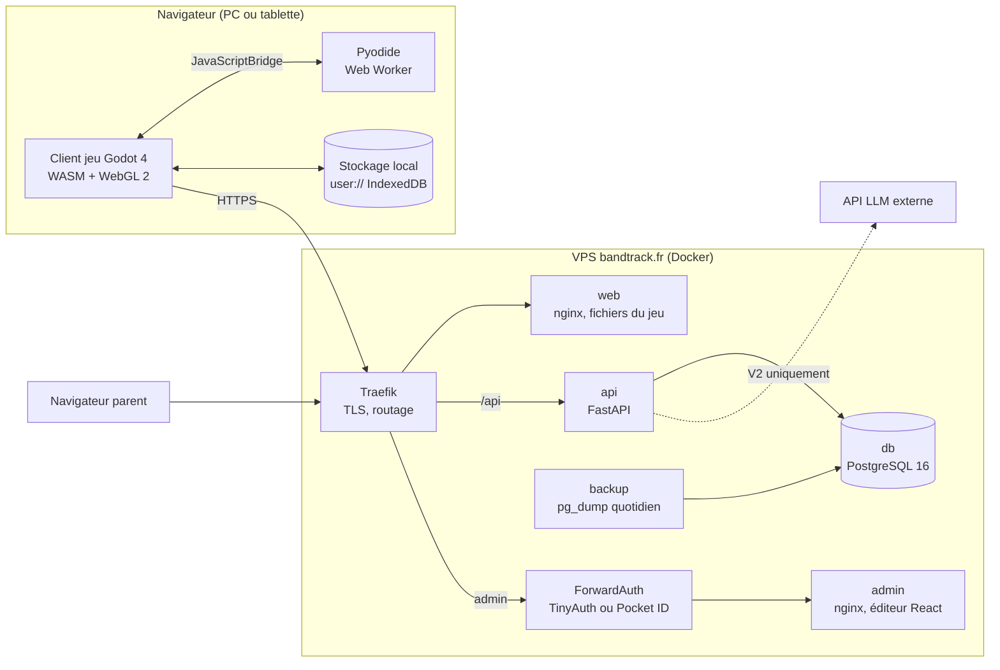
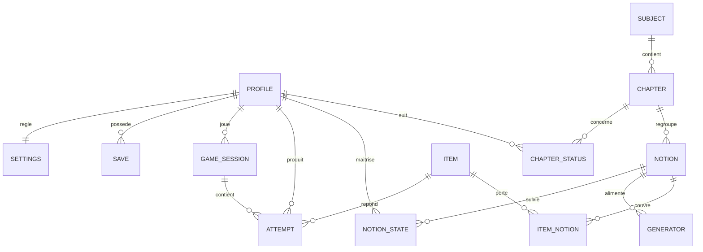

# TRD – Jeu éducatif 2.5D « Les Chroniques d'Aldoria » (titre provisoire)

10 octobre 2026 · Eric · Document compagnon du PRD du même jour

## 0. Objet et décisions structurantes

Ce TRD traduit le PRD en exigences techniques implémentables. Il fixe l'architecture, les modèles de données, les contrats d'API, les algorithmes pédagogiques, l'infrastructure et les critères de qualité.

**Décisions héritées du PRD**

| Sujet | Décision |
| --- | --- |
| Accès | Navigateur uniquement, sur le PC familial Windows et la tablette Android |
| Moteur de jeu | Godot 4, export web, renderer Compatibility (WebGL 2), export sans threads |
| Hébergement | VPS bandtrack.fr, Docker, derrière Traefik |
| Mondes | Deux mondes distincts (Jules, Tom) sur un moteur commun |
| Récompenses | Uniquement en jeu, aucune récompense réelle |
| Python de Tom | Pyodide dans le navigateur, appelé depuis Godot via JavaScriptBridge |

**Décisions prises dans ce TRD** (le PRD laissait le choix)

| Sujet | Décision | Raison |
| --- | --- | --- |
| API | FastAPI (Python 3.12+) | Générateurs de questions et vérification mathématique naturels en Python (SymPy), cohérence avec Pyodide |
| Base de données | PostgreSQL 16 | Robuste, JSONB pour les états de jeu et les spécifications d'items |
| Éditeur parent | React + TypeScript + Vite | Écosystème le plus riche, très bien maîtrisé par les assistants de code |
| Rendu des formules | LaTeX converti en SVG côté API, mis en cache, chargé par Godot | Godot n'a pas de moteur LaTeX ; le SVG reste net à toutes les tailles |
| Validation des réponses | Côté client (retour instantané), journalisée côté serveur | Retour immédiat indispensable au "game feel", et compatible avec une coupure réseau |
| Génération des items | Côté serveur, par "paquets de session" préchargés | Une session reste jouable si le réseau tombe |

## 1. Architecture générale



**Domaines** (noms provisoires)

| URL | Service | Protection |
| --- | --- | --- |
| `aldoria.bandtrack.fr` | Fichiers du jeu (web) | Aucune devant les fichiers statiques ; le contenu sensible passe par l'API |
| `aldoria.bandtrack.fr/api/v1/play/*` | API côté joueur | Jeton de profil enfant (PIN) |
| `aldoria-admin.bandtrack.fr` | Éditeur et tableau de bord parent | ForwardAuth (SSO existant) |
| `aldoria.bandtrack.fr/api/v1/admin/*` | API côté parent | ForwardAuth sur le préfixe de chemin + vérification de l'en-tête d'identité |

## 2. Client jeu (Godot 4)

### 2.1 Paramètres d'export web

| Paramètre | Valeur | Commentaire |
| --- | --- | --- |
| Version | Dernière 4.x stable au démarrage, figée ensuite | Pas de mise à jour de version en cours de phase |
| Renderer | Compatibility (WebGL 2) | Seul renderer pris en charge sur le web |
| Threads | Désactivés | Évite les en-têtes COOP/COEP, meilleure compatibilité navigateur |
| Template | Build personnalisé, modules inutiles retirés | Objectif : réduire le WASM (pas de physique avancée, pas de navigation 3D, etc.) |
| Compression textures | ETC2/ASTC + S3TC | Couvre la tablette Android et le PC |
| Shell HTML | Personnalisé | Écran de chargement aux couleurs du jeu, préchargement Pyodide différé |

### 2.2 Budgets de performance

| Indicateur | PC familial | Tablette Android |
| --- | --- | --- |
| Images par seconde | 60 | 30 minimum |
| Premier chargement (Wi-Fi domestique) | < 10 s | < 15 s |
| Chargements suivants (cache) | < 3 s | < 5 s |
| Poids téléchargé au premier lancement (compressé) | < 25 Mo | < 25 Mo |
| Appels de dessin par scène | < 150 | < 100 |
| Triangles visibles | < 150 000 | < 60 000 |
| Mémoire | < 600 Mo | < 400 Mo |

Le prototype (étape 1 du PRD) doit mesurer ces valeurs sur la tablette réelle. Si les budgets tablette ne sont pas tenus après optimisation, le plan B Babylon.js est déclenché.

### 2.3 Organisation du projet Godot

```
game/
├── project.godot
├── addons/                 # GUT (tests), outils éditeur
├── autoload/
│   ├── ApiClient.gd        # HTTP, jeton, file d'attente hors ligne
│   ├── Session.gd          # paquet de session, sélection locale des items
│   ├── SaveManager.gd      # sauvegarde locale et serveur
│   ├── QuestionService.gd  # validation des réponses, explications
│   └── PyBridge.gd         # liaison Pyodide via JavaScriptBridge
├── core/
│   ├── combat/             # combat au tour par tour
│   ├── puzzles/            # balance, miroirs, échelles...
│   ├── dialogue/
│   └── progression/        # XP, talents, étoiles, bestiaire
├── ui/
│   ├── question_widgets/   # un widget par type de question
│   └── hud/
├── worlds/
│   ├── shared/             # lore, systèmes communs
│   ├── jules/              # régions, PNJ, quêtes du monde de Jules
│   └── tom/                # régions, PNJ, quêtes du monde de Tom
├── assets/
└── tests/
```

**Principe clé** : le gameplay ne connaît jamais le contenu d'une question. Une scène demande au `QuestionService` "un item pour la notion X, difficulté Y, type compatible avec Z", reçoit un item normalisé, l'affiche via le widget adapté, puis récupère un résultat (`correct`, `temps`, `indice_utilisé`). Ce découplage permet d'ajouter une matière sans toucher au gameplay.

### 2.4 Widgets de question

| Type | Widget Godot | Validation locale |
| --- | --- | --- |
| `mcq` | Boutons (2 à 4) | Index attendu |
| `numeric` | Pavé numérique tactile + clavier | Valeur avec tolérance, fractions acceptées (`3/4`) |
| `true_false_justify` | Vrai/Faux + choix de justification | Couple attendu |
| `drag_order` | Glisser-déposer | Ordre attendu |
| `drag_match` | Glisser-déposer vers des cibles | Associations attendues |
| `place_on_figure` | Clic ou toucher sur un repère, une figure, une carte | Point dans une zone de tolérance |
| `expression` | Clavier mathématique virtuel | Équivalence numérique (voir 5.4) |
| `python` | Éditeur de code simple + console | Tests exécutés dans Pyodide (voir 2.6) |

Contraintes communes : cibles tactiles d'au moins 48 px, aucune interaction au survol, taille de texte réglable (3 niveaux), contraste suffisant.

### 2.5 Formules mathématiques

- Texte simple (fractions courtes, exposants) : `RichTextLabel` avec BBCode.
- Formules complexes : le champ `latex` de l'item est rendu en SVG par l'API (`GET /api/v1/render/latex?h=<hash>`), mis en cache côté serveur et dans le stockage local, puis chargé avec `Image.load_svg_from_buffer` à l'échelle de l'écran.
- Les SVG d'un paquet de session sont préchargés avec le paquet.

### 2.6 Pyodide (grimoire de Tom)

- Pyodide est auto-hébergé dans le conteneur `web` (pas de CDN), chargé uniquement à la première ouverture du grimoire.
- Il s'exécute dans un **Web Worker**, ce qui permet d'interrompre un code bouclant à l'infini (délai maximal : 3 s par exécution).
- Le shell HTML expose une petite API JavaScript (`aldoriaPy.run(code, tests)`) appelée depuis `PyBridge.gd` via `JavaScriptBridge`, avec réponse par callback.
- Un exercice Python = un énoncé, un squelette de code, des tests (entrées, sorties attendues) et une explication.
- Aucune bibliothèque externe au-delà de la bibliothèque standard.

### 2.7 Stockage local et mode dégradé

- Stockage dans `user://` (persisté en IndexedDB par l'export web).
- Contenu : jeton de profil, paquet de session courant, file des tentatives non envoyées, dernière sauvegarde locale, cache SVG.
- Si l'API est injoignable : le jeu continue avec le paquet de session en cours ; les tentatives sont mises en file avec un identifiant unique (UUID v4) et renvoyées à la reconnexion. Le serveur ignore les doublons (idempotence).
- Un indicateur discret signale le mode hors connexion ; aucun message bloquant.

## 3. API (FastAPI)

### 3.1 Organisation

```
api/
├── app/
│   ├── main.py
│   ├── config.py           # variables d'environnement (pydantic-settings)
│   ├── db/                 # SQLAlchemy 2, migrations Alembic
│   ├── models/
│   ├── schemas/            # Pydantic v2
│   ├── routers/
│   │   ├── play.py         # côté enfant
│   │   ├── admin.py        # côté parent
│   │   └── render.py       # LaTeX → SVG
│   ├── engine/
│   │   ├── scheduler.py    # répétition espacée (Leitner)
│   │   ├── mastery.py      # score de maîtrise
│   │   ├── selector.py     # composition des paquets de session
│   │   └── generators/     # un module par générateur
│   ├── auth/
│   └── ai/                 # V2 : génération assistée
├── tests/
└── pyproject.toml
```

### 3.2 Points d'entrée côté joueur

| Méthode | Chemin | Rôle |
| --- | --- | --- |
| GET | `/api/v1/play/profiles` | Liste des profils (prénom, avatar), sans donnée sensible |
| POST | `/api/v1/play/login` | Profil + PIN → jeton (JWT, 12 h) |
| POST | `/api/v1/play/session/start` | Ouvre une session, renvoie le paquet de session et les réglages (durée max) |
| POST | `/api/v1/play/attempts` | Envoie un lot de tentatives (idempotent par UUID) |
| POST | `/api/v1/play/session/end` | Clôt la session (durée, statistiques) |
| GET | `/api/v1/play/save` | Dernière sauvegarde serveur |
| PUT | `/api/v1/play/save` | Envoie une sauvegarde (avec `schema_version` et `base_revision`) |
| GET | `/api/v1/play/daily` | Défi quotidien du jour |
| GET | `/api/v1/play/progress` | Maîtrise par notion (affichage des étoiles) |
| POST | `/api/v1/play/report-error` | Signalement d'une question jugée fausse par l'enfant |
| GET | `/api/v1/render/latex` | SVG d'une formule (par hash) |

### 3.3 Points d'entrée côté parent

| Méthode | Chemin | Rôle |
| --- | --- | --- |
| CRUD | `/api/v1/admin/profiles` | Profils enfants, PIN, niveau, monde |
| CRUD | `/api/v1/admin/chapters` | Chapitres par matière et niveau |
| PUT | `/api/v1/admin/profiles/{id}/chapters/{cid}/status` | Statut : à venir, en cours, terminé, contrôle bientôt |
| CRUD | `/api/v1/admin/notions` | Notions rattachées aux chapitres |
| CRUD | `/api/v1/admin/items` | Items (brouillon, publié, archivé) |
| POST | `/api/v1/admin/items/import` | Import CSV ou JSON, avec rapport de validation |
| GET | `/api/v1/admin/generators` | Générateurs disponibles et leurs paramètres |
| POST | `/api/v1/admin/generators/{id}/preview` | Aperçu de 10 items générés |
| GET | `/api/v1/admin/dashboard/{profile_id}` | Notions acquises, fragiles, non vues ; temps de jeu |
| PUT | `/api/v1/admin/settings/{profile_id}` | Durée de session, ratios de mélange |
| GET | `/api/v1/admin/reports` | Signalements d'erreurs à traiter |
| POST | `/api/v1/admin/ai/draft-items` | V2 : génération d'items en brouillon depuis un texte ou une photo |
| DELETE | `/api/v1/admin/profiles/{id}/data` | Réinitialisation complète d'un profil (droit à l'effacement) |

Documentation OpenAPI générée automatiquement, exposée uniquement côté admin.

### 3.4 Conventions

- JSON en `snake_case`, dates en ISO 8601 UTC.
- Erreurs au format `{"error": {"code": "...", "message": "..."}}`.
- Versionnement par préfixe `/api/v1`.
- Pagination par curseur sur les listes longues (items, tentatives).

## 4. Modèle de données



**Tables principales**

| Table | Champs clés | Remarques |
| --- | --- | --- |
| `profile` | id, prenom, avatar, niveau (`6e`, `2nde`), monde (`jules`, `tom`), pin_hash | PIN haché en Argon2id |
| `settings` | profile_id, duree_max_min, ratio_chapitre, ratio_revision, ratio_automatismes | Valeurs par défaut 25 / 0,5 / 0,3 / 0,2 |
| `subject` | id, code, libelle | `maths`, `francais`, `lv`, `hg`, `emc`, `sciences`, `ses`, `snt`, `arts`, `eps` |
| `chapter` | id, subject_id, niveau, titre, ordre | |
| `chapter_status` | profile_id, chapter_id, statut, date_controle | Statuts : `a_venir`, `en_cours`, `termine`, `controle_bientot` |
| `notion` | id, chapter_id, code, libelle, est_automatisme | Code stable, ex. `6e.maths.fractions.addition` |
| `item` | id, type, difficulte (1 à 5), spec (JSONB), statut, source, version | `source` : `manuel`, `import`, `ia` |
| `item_notion` | item_id, notion_id | Un item peut couvrir plusieurs notions |
| `generator` | id, code, notion_id, params (JSONB), actif | Le code renvoie au module Python |
| `notion_state` | profile_id, notion_id, boite (1 à 5), due_at, maitrise (0 à 100), nb_vues, derniere_vue | Clé primaire composite |
| `game_session` | id, profile_id, debut, fin, nb_questions, nb_justes | |
| `attempt` | id (UUID client), profile_id, session_id, item_id ou item_genere (JSONB), notion_ids, correct, temps_ms, indice, created_at | Les items générés sont stockés en ligne |
| `save` | id, profile_id, revision, schema_version, data (JSONB), created_at | 20 dernières révisions conservées |
| `error_report` | id, profile_id, item_ref, commentaire, statut | |
| `daily_challenge` | profile_id, date, items (JSONB), score | |

## 5. Moteur pédagogique

### 5.1 Format d'un item

```json
{
  "id": "it_01HZX...",
  "type": "numeric",
  "difficulty": 2,
  "notions": ["6e.maths.fractions.addition"],
  "prompt": "Calcule et donne le résultat sous forme de fraction.",
  "latex": "\\frac{2}{3} + \\frac{1}{4}",
  "answer": { "kind": "fraction", "value": "11/12", "accept_equivalent": true },
  "hint": "Cherche un dénominateur commun à 3 et 4.",
  "explanation": "On met au même dénominateur 12 : 8/12 + 3/12 = 11/12.",
  "time_target_ms": 30000
}
```

Le schéma JSON complet de chaque type est versionné dans `content/schemas/` et utilisé à la fois par l'API (validation à l'import) et par le client (tests).

### 5.2 Générateurs

- Un générateur est une fonction Python pure, déterministe à graine fixée : `generate(params, difficulty, seed) -> Item`.
- Les paramètres bornent la génération (ex. dénominateurs entre 2 et 12, résultat non simplifiable ou simplifiable, nombres positifs).
- Chaque générateur fournit l'explication adaptée aux valeurs tirées.
- Tests obligatoires : 1 000 tirages par niveau de difficulté sans erreur, réponses vérifiées par un calcul indépendant (SymPy).
- Cible MVP : 20 générateurs par niveau en mathématiques.

### 5.3 Répétition espacée (Leitner)

| Boîte | Intervalle avant nouvelle présentation |
| --- | --- |
| 1 | Même session puis 1 jour |
| 2 | 3 jours |
| 3 | 7 jours |
| 4 | 21 jours |
| 5 | 60 jours |

- Réponse juste sans indice : boîte +1.
- Réponse juste avec indice : boîte inchangée.
- Réponse fausse : retour en boîte 1, nouvelle présentation dans la même session sous une autre forme (autre item ou autre type).
- L'algorithme est isolé derrière une interface `Scheduler` pour pouvoir passer à FSRS plus tard sans toucher au reste.

### 5.4 Maîtrise et validation

**Score de maîtrise** (0 à 100), moyenne mobile exponentielle sur les tentatives :

```
gain = 1 si juste, 0 si faux
gain = gain × 0,6 si indice utilisé
gain = gain × facteur_temps (1 si temps ≤ cible, décroît jusqu'à 0,7 à 3 × la cible)
maîtrise = maîtrise × (1 − α) + 100 × gain × α, avec α = 0,25 × (0,6 + 0,1 × difficulté)
```

Seuils d'affichage : moins de 40 = non acquis, 40 à 74 = fragile, 75 et plus = acquis (étoiles d'Archives : 1, 2, 3).

**Équivalence d'expressions** (type `expression`) : le client évalue l'expression saisie et l'expression attendue en 8 points tirés au hasard (classe `Expression` de Godot) ; égalité à 1e-6 près sur tous les points = juste. La forme attendue peut être imposée (ex. "forme factorisée") via une règle de motif vérifiée en plus.

**Détection du clic au hasard** : 3 réponses fausses consécutives en moins de 25 % du temps cible chacune déclenchent une réduction des gains de jeu pour les 5 questions suivantes, sans message punitif.

### 5.5 Composition d'un paquet de session

À l'appel `session/start`, l'API construit un paquet d'environ 60 items :

1. **Chapitre en cours** (50 %) : notions des chapitres `en_cours`, priorité à celles de maîtrise faible. Si un chapitre est `controle_bientot`, il prend 70 % à lui seul.
2. **Révisions espacées** (30 %) : notions dont `due_at` est dépassé, les plus en retard d'abord.
3. **Automatismes** (20 %) : notions marquées `est_automatisme`.
4. Difficulté visée : maintenir 70 à 85 % de réussite sur les 20 dernières tentatives ; ajustement de ±1 niveau.
5. Diversité : pas deux fois le même item dans un paquet, pas plus de 3 items consécutifs sur la même notion.

Chaque item du paquet est étiqueté avec les types de jeu compatibles (combat, énigme, dialogue) pour que le client puisse piocher selon la scène.

## 6. Éditeur et tableau de bord parent

- React 18+, TypeScript, Vite, bibliothèque de composants légère (ex. shadcn/ui), React Query pour les appels API.
- Écrans MVP : profils, chapitres et statuts, notions, items (liste, édition avec aperçu rendu, import), générateurs (aperçu), tableau de bord par enfant, signalements, réglages.
- Aperçu d'un item identique au rendu en jeu (formules en SVG via l'API).
- Import CSV : une ligne par item, colonnes documentées ; rapport ligne par ligne des erreurs avant validation.
- V2 : écran "Créer depuis une source" (texte collé ou photo de cahier) produisant des items en brouillon à relire un par un.

## 7. Génération assistée par IA (V2)

- Appel LLM uniquement depuis les routes admin, déclenché par le parent.
- Entrée : texte ou image de cours, chapitre cible, types d'items souhaités, nombre.
- Sortie exigée : JSON conforme au schéma d'item ; tout item non conforme est rejeté.
- Statut forcé à `brouillon` ; publication uniquement après validation manuelle.
- Aucune donnée d'enfant (prénom, résultats) dans les requêtes.
- Clé d'API dans les secrets Docker, jamais dans le dépôt.

## 8. Sécurité

| Sujet | Mesure |
| --- | --- |
| Transport | HTTPS partout (Let's Encrypt via Traefik), HSTS |
| Parent | ForwardAuth (TinyAuth ou Pocket ID) devant l'admin et `/api/v1/admin` ; l'API vérifie en plus l'en-tête d'identité transmis par le middleware et refuse toute requête admin sans lui |
| Enfants | PIN à 4 chiffres haché (Argon2id), 5 essais puis blocage 5 minutes, jeton JWT signé (HS256, 12 h) |
| En-têtes | CSP stricte (`script-src 'self' 'wasm-unsafe-eval'`), `X-Content-Type-Options`, `Referrer-Policy` |
| Dépendances | Pyodide et toutes les bibliothèques auto-hébergées, aucun appel à un CDN tiers |
| Entrées | Validation Pydantic systématique, taille maximale des requêtes, import limité à 5 Mo |
| Secrets | Variables d'environnement via fichier `.env` hors dépôt ou secrets Docker |
| Base | Utilisateur PostgreSQL dédié, non exposé hors du réseau Docker interne |

## 9. Données et RGPD

- Données minimales : prénom ou pseudo, niveau, monde, réponses, scores, temps de jeu. Pas d'e-mail, pas de photo, pas de géolocalisation.
- Aucun traceur, aucune analytique tierce, aucune police ou ressource chargée depuis un tiers.
- Effacement : la route `DELETE /admin/profiles/{id}/data` supprime tentatives, états, sauvegardes et sessions du profil.
- Journaux applicatifs sans données de réponse, conservés 30 jours.
- Hébergement du VPS à confirmer en UE.

## 10. Infrastructure et déploiement

### 10.1 Conteneurs

| Service | Image de base | Rôle |
| --- | --- | --- |
| `web` | nginx:alpine | Fichiers du jeu (export Godot), Pyodide ; MIME `application/wasm`, compression Brotli et gzip, cache long sur les fichiers versionnés |
| `api` | python:3.12-slim | FastAPI servi par Uvicorn (2 workers) |
| `db` | postgres:16-alpine | Base, volume persistant |
| `admin` | nginx:alpine | Éditeur React compilé |
| `backup` | postgres:16-alpine + cron | `pg_dump` quotidien, rétention 14 jours, copie hors du VPS |

### 10.2 Structure du dépôt

```
aldoria/
├── game/            # projet Godot
├── api/             # FastAPI
├── admin/           # React
├── content/
│   ├── schemas/     # schémas JSON des items
│   └── seed/        # banque de départ (items, chapitres, notions)
├── deploy/
│   ├── docker-compose.yml
│   ├── nginx/
│   └── .env.example
└── docs/
    ├── PRD.md
    └── TRD.md
```

### 10.3 Exemple de labels Traefik (service web)

```yaml
labels:
  - traefik.enable=true
  - traefik.http.routers.aldoria-web.rule=Host(`aldoria.bandtrack.fr`)
  - traefik.http.routers.aldoria-web.entrypoints=websecure
  - traefik.http.routers.aldoria-web.tls.certresolver=letsencrypt
  - traefik.http.services.aldoria-web.loadbalancer.server.port=80
```

Les noms de réseau, d'entrypoint et de certresolver sont à aligner sur la configuration Traefik existante du VPS.

### 10.4 Intégration et livraison continues

- Pipeline (GitHub Actions ou Gitea Actions) : tests API (pytest), tests Godot (GUT en mode headless), build admin, export web Godot en mode headless, construction des images, déploiement par `docker compose pull && up -d`.
- Fichiers du jeu versionnés par hash pour éviter qu'un navigateur garde une ancienne version en cache.
- Migrations Alembic appliquées automatiquement au démarrage du conteneur `api`.

### 10.5 Supervision

- Point `/api/v1/health` (API + base) utilisé par le healthcheck Docker.
- Journaux structurés JSON, consultables avec `docker logs`.
- Option : surveillance externe de disponibilité si un outil est déjà en place sur le VPS.

## 11. Qualité et tests

| Niveau | Outil | Couverture attendue |
| --- | --- | --- |
| Moteur pédagogique | pytest | Scheduler, maîtrise, sélecteur : 90 % des lignes |
| Générateurs | pytest + SymPy | 1 000 tirages par difficulté, réponses vérifiées |
| API | pytest + httpx | Toutes les routes, cas d'erreur, idempotence des tentatives |
| Client | GUT | Validation des réponses, file hors ligne, sauvegarde |
| Admin | Playwright | Parcours principaux : créer un item, importer un CSV, changer un statut |
| Appareils | Manuel | PC familial (Chrome, Edge) et tablette Android (Chrome) à chaque version |
| Contenu | Relecture parent | Tout item publié a été relu ; signalements traités sous 7 jours |

**Critères de sortie du prototype** : budgets de performance de la section 2.2 tenus sur la tablette, chargement de Pyodide inférieur à 8 s sur la tablette, aucune perte de tentative après coupure réseau simulée.

## 12. Sauvegardes de partie

- Sauvegarde automatique en fin de combat, de salle ou de session, d'abord en local puis sur le serveur.
- Chaque sauvegarde porte `schema_version` (format) et `base_revision` (révision serveur de départ).
- Conflit (sauvegarde serveur plus récente venant d'un autre appareil) : la révision la plus avancée en progression gagne ; l'autre est conservée dans l'historique.
- Migrations de format gérées côté client à l'ouverture (`SaveManager.migrate(from, to)`).

## 13. Correspondance avec la roadmap du PRD

| Étape PRD | Livrables techniques |
| --- | --- |
| Prototype "combat" | Export web Godot minimal, 1 scène de combat, 3 types de widgets (`mcq`, `numeric`, `expression`), 4 générateurs, API `login` + `session/start` + `attempts`, mesures sur tablette |
| Tranche verticale | Scheduler Leitner, maîtrise, paquets de session complets, sauvegardes, file hors ligne, tableau de bord minimal |
| MVP | Tous les widgets sauf `python`, 20 générateurs par niveau, éditeur parent complet, import CSV, défi quotidien, CI/CD, sauvegardes base |
| V2 | Widget `python` + Pyodide, génération IA, résumé hebdomadaire, contenus français et langues |
| V3 | Contenus HG, EMC, sciences, saisons, arène coopérative (si retenue) |
| V4 | Contenus SES, SNT, arts, musique, EPS, cache hors ligne étendu |

## 14. Points techniques à valider

- [ ] Poids réel de l'export web Godot après retrait des modules, et temps de chargement sur la tablette.
- [ ] Fluidité du rendu 2.5D sur la tablette avec le renderer Compatibility.
- [ ] Temps de chargement de Pyodide dans un Web Worker sur la tablette.
- [ ] Bibliothèque de rendu LaTeX vers SVG côté API (qualité et couverture des notations de seconde).
- [ ] Choix définitif du fournisseur SSO pour l'admin (TinyAuth ou Pocket ID).
- [ ] Localisation UE de l'hébergement du VPS.
