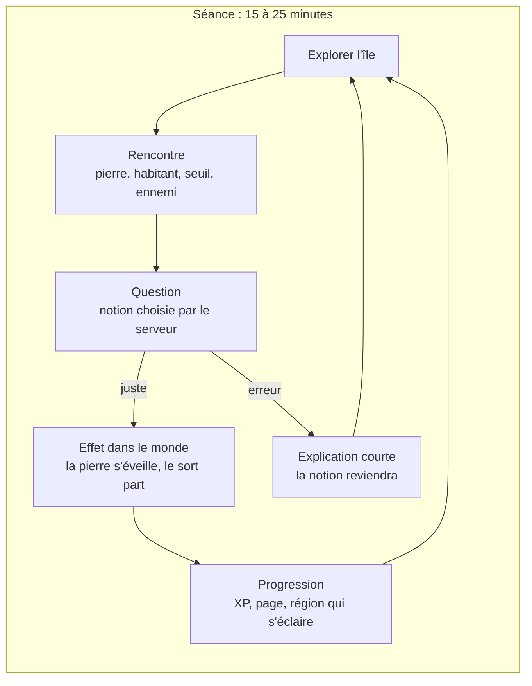

# PRD v2 : Les Chroniques d'Aldoria

7 novembre 2026 · Eric · Remplace le PRD de la v1 (`docs/PRD.md` à la racine) pour tout ce qui concerne le jeu.
Le moteur pédagogique, l'espace parent et les règles sur les données ne changent pas : leur PRD reste celui de la v1.

## 1. Vision

Un jeu d'aventure en 3D, à la troisième personne, sur une île qu'on parcourt librement, où chaque pierre, chaque habitant et
chaque lieu de quête repose sur une notion du programme de l'enfant. Il se joue dans le navigateur du PC familial.

**Ce qui ne change pas** : les enfants lancent le jeu pour l'aventure et révisent sans s'en rendre compte. La pédagogie est le
moteur caché, le jeu est la façade. Le savoir est un pouvoir ; l'erreur ne coûte jamais la progression ; le parent pilote.

**Ce qui change** : on ne regarde plus des salles d'en haut, on est dans le monde. On voit la Citadelle au loin, on marche
vers les montagnes des Cimes Fractales, on entend la mer près de la Bibliothèque des Langues, on découvre un lieu de quête
derrière une colline. L'immersion devient la récompense de l'exploration.

## 2. Ce qui change par rapport à la v1

| Sujet | v1 (prototype) | v2 |
| --- | --- | --- |
| Appareils | PC, tablette Android, téléphone | **PC seulement**, navigateur récent (Chrome, Edge, Firefox) |
| Commandes | toucher, joystick virtuel, clavier | clavier et souris (ZQSD ou flèches, souris pour regarder, E pour agir, clic sur le sol pour y aller) ; manette ensuite |
| Monde | salles de donjon en vue inclinée, carte du royaume en hexagones, une scène par activité | **une île continue** en troisième personne ; les lieux de quête sont des intérieurs qu'on rejoint à pied |
| Rendu | bridé par la tablette (fausses lumières, sans ombres) | low-poly enrichi : sol en facettes, ombres sur tout le paysage, ciel en dégradé, brouillard, halo, occlusion ambiante |
| Questions | panneaux posés sur une salle | objets du monde : pierres de savoir, seuils, habitants, Effaceurs ; même panneau HTML lisible |
| Moteur | Godot 4 (WebGL 2 Compatibility) | Babylon.js 9 + TypeScript, interface React |
| Données | progression pédagogique, banque, familles | **les mêmes** (même API, même base) ; seule la partie (XP, lieux, apparence) a un nouveau format |

## 3. Personas

Inchangés (PRD de la v1, §3). Une précision : **le support est le PC familial**, clavier et souris. Tom (15 ans) peut jouer sur
un autre PC du foyer relié à la famille ; le téléphone n'est plus une cible.

| | Jules (6e) | Tom (2nde) |
| --- | --- | --- |
| Monde | lumineux : fin d'après-midi dorée, renard compagnon | Brouillard : matin voilé, sobre et mystérieux |
| Ce que l'île doit lui donner | explorer, collectionner, personnaliser, un compagnon | défi, progression visible, liberté, une histoire plus sombre |

## 4. Le monde : l'île d'Aldoria

Une île d'environ 500 m de large (`content/monde/ile.json`), qu'on traverse en courant en un peu plus d'une minute (plus longtemps en contournant les forêts et les montagnes).

- **La Citadelle des Archives** au centre : Maître Ysaline, la Grande Chronique (Archives), la salle d'armes (apparence), la Lice,
  la Pierre du Jour (défi quotidien). Le héros apparaît à ses portes.
- **Une région par matière**, avec son paysage : les Cimes Fractales (maths, montagnes), le Laboratoire des Inventeurs
  (sciences, plateau), la Bibliothèque des Langues (langues, côte), la Vallée du Vivant (SVT, vallée), le Bois des Mots
  (français, forêt), le Carrefour des Messagers (SNT, falaises), les Portes du Temps (histoire-géographie, collines), le Forum
  des Citoyens (EMC et SES, plaine près de la Citadelle). Une matière peut loger chez une autre (comme dans la v1).
- **Les lieux de quête** (les 30 donjons de la v1) : une tour ou un bâtiment par lieu, jusqu'à trois par région, ouverts l'un
  après l'autre. Devant chacun, un **seuil** : Maître Ysaline présente le lieu et la quête, l'enfant choisit « J'y vais » ou
  « Pas maintenant ». À l'intérieur : salles, rencontres, énigme, Effaceur, coffre et page de la Chronique.
- **Les pierres de savoir** : une près de la Citadelle, une au cœur de chaque région. Une bonne réponse l'éveille pour la
  journée (XP, cristal doré). C'est la révision du quotidien, en chemin.
- **Le village de Clairval** (à l'ouest) : ses habitants confient leurs quêtes de trois questions par jour (révision, veille
  de contrôle, enquête).
- **L'île du Sphinx**, au large à l'est : jeux de logique sans questions de leçon (idée de Jules), rejointe en barque avec un
  passage gagné ailleurs.
- **La Tour de l'Oubli**, au nord : le repaire de Malvrek, fermée tant que l'enfant n'a pas repris assez de pages et maîtrisé
  assez de notions.
- **Le brouillard de l'oubli** couvre les régions pas encore au programme de l'enfant ; il recule quand une page revient.

## 5. Boucles de jeu

Les boucles de chapitre (un lieu de quête par chapitre en classe) et de saison (une nouvelle région par année scolaire) sont
celles de la v1.

## 6. Ce qui porte les questions dans l'île

| Mécanique | Où | Questions | Phase |
| --- | --- | --- | --- |
| Pierres de savoir | toute l'île | automatismes et chapitre en cours, une par pierre et par jour | 0 (fait) |
| Seuils | devant chaque lieu | aucune : le choix d'entrer | 0 (fait) |
| Rencontres au tour par tour | dans les lieux, puis quelques gardiens dehors | le combat de la v1 (`Encounter`), joué dans le décor, temps figé pendant la question | 1 |
| Effaceurs (boss) | au sommet de chaque lieu | évaluation du chapitre (sceaux) | 1 |
| Énigmes de lieu | dans les lieux | balance géante, tir calculé, pont des fractions, frises… (générateurs `enigme` de l'API) | 2 |
| Habitants | Clairval | quêtes de révision, de veille, d'enquête | 2 |
| Pierre du Jour | Citadelle | défi quotidien d'automatismes, série et coffre de la semaine | 2 |
| Île du Sphinx | au large | logique, aucune leçon | 2 |

Règle d'accessibilité qui ne bouge pas : **aucune question ne se joue contre la montre**. Le monde se fige quand un panneau
s'ouvre ; aucune esquive ni action rapide n'est demandée pour répondre.

## 7. Exigences fonctionnelles

| ID | En tant que | Je veux | Afin de | Priorité |
| --- | --- | --- | --- | --- |
| V2-01 | Joueur | me déplacer librement dans l'île au clavier et à la souris, ou d'un clic sur le sol | me sentir dans le monde | P0 (fait) |
| V2-02 | Joueur | savoir où je suis (nom de la région, mini-carte qu'on cache avec M) et ce que je peux faire (« E : … ») | ne jamais être perdu | P0 (fait) |
| V2-03 | Joueur | éveiller les pierres de savoir en répondant juste | réviser en chemin | P0 (fait) |
| V2-04 | Joueur | entendre et lire Maître Ysaline au seuil d'un lieu | comprendre la quête avant d'entrer | P0 (fait) |
| V2-05 | Joueur | entrer dans un lieu, y combattre, résoudre son énigme et vaincre son Effaceur | rapporter une page | P1 |
| V2-06 | Joueur | retrouver ma partie sur un autre PC | jouer où je veux | P0 (fait, emplacement v2) |
| V2-07 | Joueur | jouer sans compte pour découvrir l'île | essayer avant de se connecter | P0 (fait, rien n'est enregistré) |
| V2-08 | Joueur | personnaliser mon héros et retrouver mon renard | avoir un héros à moi | P1 |
| V2-09 | Joueur | voir les régions s'éclairer quand je rapporte leurs pages | voir ma progression dans le monde | P1 |
| V2-10 | Parent | voir les séances d'exploration dans le tableau de bord | suivre le jeu v2 comme la v1 | P0 (fait : « Exploration ») |
| V2-11 | Parent | que la v1 et la v2 cohabitent pendant la transition | ne rien perdre | P0 (fait : emplacements de sauvegarde) |

Les user stories de la v1 (US-01 à US-15) restent valables ; « US-02 explorer en 2.5D » devient V2-01.

## 8. Exigences non fonctionnelles

| Thème | Exigence |
| --- | --- |
| Plateforme | PC Windows ou Linux, navigateur avec WebGL 2 (WebGPU plus tard) ; écran de 1280 × 720 au moins |
| Fluidité | 60 images par seconde au profil `haut` sur le PC familial ; profil `moyen` ou `bas` sinon (`?qualite=`) |
| Chargement | écran titre en moins de 2 s ; île jouable en moins de 15 s au premier lancement, 5 s ensuite |
| Hors connexion | inchangé : une coupure ne bloque jamais le jeu, les réponses partent au retour du réseau |
| Accessibilité | inchangée (aménagements du parent) ; en plus, tout le texte est du vrai texte HTML (zoom, lecteur d'écran) |
| Données | inchangé : aucune donnée hors du serveur d'Aldoria, aucune ressource chargée depuis un tiers (CSP) |
| Temps d'écran | inchangé : limite du parent, rappel de pause, pas de mécanique addictive |

## 9. Direction artistique

**Low-poly enrichi.** On garde les modèles KayKit et Quaternius (CC0) de la v1 et leur style rond et coloré ; l'immersion vient
de la lumière et de l'espace : sol en facettes teinté par région, ombres portées jusqu'à 180 m, ciel en dégradé avec un disque
de soleil, brouillard qui fond l'horizon, halo sur les cristaux et les seuils, occlusion ambiante au profil `haut`. Les deux
ambiances de la v1 deviennent deux heures et deux météos de la même île.

À venir (phase 3) : eau animée, herbe et fleurs, nuages qui passent, sons d'ambiance par région, cycle jour et nuit léger.

## 10. Risques et questions ouvertes

| Risque ou question | Parade ou décision attendue |
| --- | --- |
| L'île paraît vide entre deux lieux | pierres de savoir, gardiens, habitants dehors, objets à trouver ; mesurer en séance où les enfants s'ennuient |
| Mal des transports, caméra difficile pour un enfant dyspraxique | caméra qui revient seule derrière le héros, déplacement au clic, vitesse réglable ; à observer en séance |
| Combat au tour par tour dans un monde en temps réel | le monde se fige pendant la question ; **à trancher avec les enfants** : rencontres visibles qui approchent, ou combat déclenché au contact |
| Poids du premier chargement | budget de `docs/TRD.md` §8 suivi dans `docs/perf-log.md` ; imports ciblés de Babylon.js si besoin |
| Abandon de la tablette | Jules jouait sur la tablette : **à confirmer avec lui** qu'il a accès au PC assez souvent |
