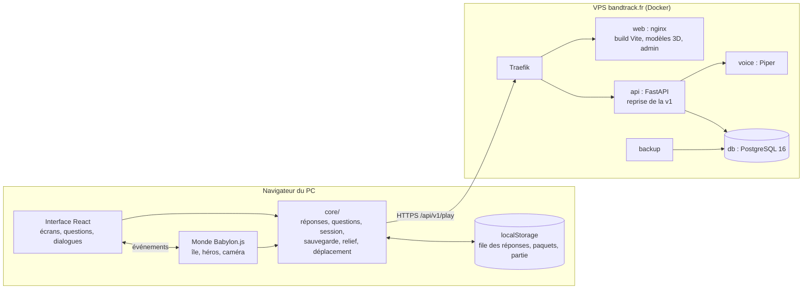

# TRD v2 : Les Chroniques d'Aldoria

7 novembre 2026 · Compagnon de `docs/PRD.md` (v2). Les décisions et leur raison : `docs/decisions.md`. Le TRD de la v1
(`docs/TRD.md` à la racine) reste la référence pour l'API, le moteur pédagogique, le modèle de données et la sécurité, qui
sont repris sans changement de fond ; ce document décrit ce qui est nouveau ou différent.

## 0. Décisions structurantes

| Sujet | Décision | Détail |
| --- | --- | --- |
| Appareils | PC seulement, navigateur récent | D1 |
| Moteur 3D | Babylon.js 9, TypeScript strict | D2 |
| Interface | HTML et CSS (React 19) au-dessus du canevas 3D | D3 |
| Monde | une île continue, troisième personne ; lieux de quête en intérieurs | D4 |
| Style | low-poly enrichi (KayKit, Quaternius, sol en facettes, lumière soignée) | D5 |
| Données | même API, même base ; partie v2 dans son propre emplacement | D6 |
| Contenu du monde | JSON dans `content/monde/`, jamais dans le code | D7 |
| Déplacement | règles pures (eau, pentes, cercles d'obstacles) sans moteur physique | D8 |
| Rendu | WebGL 2 par défaut ; WebGPU évalué en phase 0 | D9 |
| CSP | stricte (`style-src 'self'`, rien hors du site), vérifiée par les tests navigateur | D10 |

## 1. Architecture



Trois couches dans le client, et une seule règle de dépendance : `ui/` et `game/` dépendent de `core/`, jamais l'inverse ;
`ui/` ne touche pas à Babylon.js et `game/` ne connaît pas React. Ils se parlent par `GameWorld.events` (émetteur typé,
`core/events.ts`) et par quelques méthodes (`setInputEnabled`, `stoneAnswered`).

## 2. Client (`v2/client/`)

### 2.1 Organisation

```
client/
├── index.html, vite.config.ts (CSP de prévisualisation), tsconfig.json (strict)
├── public/ressources/      # servi tel quel : modèles 3D, polices, sons, interface (reprise de la v1)
├── src/
│   ├── main.tsx            # services + interface
│   ├── app/services.ts     # API, stockage, session, questions, voix
│   ├── core/               # TypeScript pur, testé sans navigateur
│   │   ├── answers.ts, mathExpr.ts      # validation (même verdict que l'API)
│   │   ├── questionService.ts           # choix adaptatif des questions
│   │   ├── session.ts, api.ts, storage.ts, save.ts
│   │   ├── accessibility.ts, voice.ts, answerText.ts, events.ts, items.ts
│   │   └── world/          # terrain.ts (relief), heightGrid.ts, movement.ts, obstacles.ts, places.ts
│   ├── game/               # Babylon.js seulement
│   │   ├── GameWorld.ts    # orchestre l'île, le héros, la caméra, les interactions
│   │   ├── engine.ts, quality.ts, theme.ts, atmosphere.ts (ciel, soleil, ombres, post-traitement)
│   │   ├── island.ts (sol en facettes, mer), decor.ts (bâtiments, forêts, Sphinx), assets.ts
│   │   └── characters.ts   # héros et habitants KayKit, renard Quaternius, animations
│   └── ui/                 # React seulement : App, Title, Login, GameScreen, QuestionPanel, widgets/, Dialogs, styles.css
├── tests/                  # Vitest : vecteurs partagés, questions, session, sauvegarde, relief, déplacement
└── e2e/                    # smoke.mjs (parcours), captures.mjs (vérification visuelle)
```

### 2.2 Rendu

| Élément | Choix | Pourquoi |
| --- | --- | --- |
| Sol | maillage construit depuis `HeightGrid`, rendu en facettes (une couleur et une normale par triangle), teinté par région, sable, roche et neige selon l'altitude et la pente | style low-poly des modèles ; le héros marche sur les triangles qu'on voit |
| Ciel | voûte en dégradé (couleurs par sommet), disque du soleil en panneau | stylisé, fondu dans le brouillard, sans shader particulier |
| Lumière | soleil directionnel + lumière d'ambiance ; ombres en cascades (1 à 3) jusqu'à 180 m | relief lisible, profondeur |
| Post-traitement | rendu HDR, tonalité ACES, vignette, halo (bloom), halo des objets lumineux (glow), occlusion ambiante (SSAO2, profil `haut`) | ce que la v1 ne pouvait pas faire |
| Décor | un modèle chargé une fois ; forêts, rochers et nuages en *thin instances* (un appel de dessin par modèle) | quelques milliers d'arbres pour moins de 300 appels |
| Personnages | `.glb` KayKit avec leurs 76 animations, fondu entre animations ; pièces d'équipement cachées par nom de nœud | même apparence que la v1 |

Profils (`?qualite=`, `game/quality.ts`) : `haut` (défaut), `moyen`, `bas`. Ils ne changent que des réglages (taille des
ombres, cascades, MSAA, SSAO, halo, densité de végétation, résolution), jamais le code d'une scène.

### 2.3 Moteur : WebGL 2 puis WebGPU

`game/engine.ts` crée un moteur WebGL 2. `?moteur=webgpu` essaie WebGPU : Babylon.js a besoin de convertir certains shaders
(twgsl), d'ordinaire chargé depuis un CDN que la CSP interdit. Étape 0.4 du plan : servir ces fichiers depuis le site, mesurer,
puis choisir le moteur par défaut. Tout le code de rendu passe par l'API commune de Babylon.js et ne dépend pas du moteur.

### 2.4 Déplacement et caméra

- `core/world/movement.ts` : vitesse de course 6,5 m/s, marche 2,8 m/s (Maj) ; refus de l'eau profonde (plus de 0,7 m) et des
  pentes de plus de 50° en glissant le long de l'obstacle ; ralenti dans l'eau ; cercles d'obstacles (`obstacles.ts`, grille
  de cases de 16 m). Le renard et les futurs personnages utilisent les mêmes règles.
- Commandes : `KeyboardEvent.code` (position de la touche : ZQSD sur AZERTY, WASD sur QWERTY), flèches, E ou Entrée pour agir,
  clic sur le sol pour y aller (aménagement « gestes »).
- Caméra orbitale autour du héros (souris, molette), qui revient seule derrière lui quand on avance sans toucher la souris
  depuis 1,8 s, et ne passe jamais sous le relief. Sa cible se modifie **en place** (réaffecter `camera.target` recalcule
  ses angles et annule la souris).

### 2.5 Interface et accessibilité

- Tout texte est du HTML : panneau de question, dialogues de Maître Ysaline, seuils, options, connexion. Les formules sont
  rendues par KaTeX (repli sur le SVG de l'API si KaTeX ne sait pas les lire).
- Les aménagements du parent (`Profile.accommodations`, inchangés) deviennent des attributs de `<html>`
  (`data-text-size`, `data-readable-font`, `data-spacing`, `data-big-targets`, `data-calm`, `data-colorblind`) ; `ui/styles.css`
  fait le reste. L'enfant peut agrandir le texte, pas descendre sous le choix du parent.
- Lecture à voix haute : voix du serveur (`POST /play/speech`) si l'enfant est connecté, sinon voix du navigateur.
- Aucun style en ligne écrit dans le HTML : React passe ses styles par l'objet `style` (autorisé par la CSP), le reste par
  des classes et des attributs `data-*`.

### 2.6 Session, hors connexion et sauvegarde

- `core/session.ts` : paquet de session (`POST /play/session/start`, mode `monde`), file des réponses avec UUID dans le
  stockage local, envoi par lots de 50, refus définitifs écartés (400, 403, 404, 409, 413, 422), dernier paquet gardé pour
  jouer hors connexion. Mode découverte : aucune réponse n'est enregistrée.
- `core/save.ts` : partie v2 (`slot: "v2"`, `schema_version` 1) : XP, lieux terminés, pierres éveillées (par jour), étapes
  de l'histoire vues, apparence. La maîtrise des notions n'y est pas : le serveur la calcule depuis les réponses.

### 2.7 Le crochet de test

Avec `?e2e`, `window.__aldoria` expose le monde (`heroPosition`, `teleport`, `frame`, `scene`, `camera`) et la question
affichée. C'est le seul mécanisme de test et de capture (la v1 en avait une quinzaine). `?decouverte` ouvre l'île sans
compte, `?classe=2nde`, `?monde=brouillard`, `?qualite=`, `?perf` (compteur), `?interface=0` (captures sans interface).

## 3. Données du monde (`v2/content/monde/`)

| Fichier | Contenu | Lu par |
| --- | --- | --- |
| `ile.json` | graine, rayon, position de la Citadelle, du départ, du village, des secrets, de l'île du Sphinx ; centre, relief, teinte et orientation de chaque région | `core/world/terrain.ts` |
| `lieux.json` | les 30 lieux de quête de la v1 : classe, matière, région, ordre, chapitres, textes (seuil, intro, page, répliques de l'Effaceur), énigme, salles et ennemis | `core/world/places.ts` ; vérifié par `api/tests/test_dungeon.py` |
| `regions.json` | titre et texte de brouillard des régions, matières logées chez une autre, lieux secrets, textes de la Citadelle | client |
| `villages.json` | Clairval et Brumegarde, habitants et quêtes | client (phase 2) |
| `heros.json` | phrases du héros entre deux lieux, par ambiance | client (phase 1) |

Règles : ces fichiers font foi (le script `tools/export_v1_content.py` ne se relance plus) ; un lieu ajouté passe les tests de
l'API (chapitres du programme, énigme du bon niveau) et ceux du client (posé sur un replat de sa région, à plus de 15 m des
autres) ; les positions de la v1 restent sous des clés `v1_` à titre d'information.

## 4. API (`v2/api/`)

Reprise entière de la v1 (FastAPI, SQLAlchemy, Alembic, 1 876 tests). Changements v2 :

| Changement | Détail |
| --- | --- |
| Emplacement de sauvegarde | `save_revision.slot` (`v1` ou `v2`), clé primaire `(profile_id, slot, revision)`, migration 0013 ; `GET /play/save?slot=v2`, `PUT /play/save` avec `"slot": "v2"`. Les révisions, conflits et époques sont propres à chaque emplacement. |
| Mode de session `monde` | séances dans l'île ouverte ; affiché « Exploration » dans le tableau de bord du parent |
| Données des lieux | `tests/test_dungeon.py` lit `content/monde/lieux.json` au lieu du GDScript |

À prévoir : aucun nouveau point d'entrée pour les phases 0 et 1. Une phase qui en ajoute un met à jour ce tableau.

## 5. Tests

| Niveau | Outil | Ce qui est couvert |
| --- | --- | --- |
| API | pytest (`uv run pytest -q`) | inchangé (1 876 tests), plus les emplacements de sauvegarde |
| Logique du client | Vitest (`npm test`) | 81 vecteurs de réponses partagés avec l'API, expressions, choix adaptatif des questions, notion ratée qui revient, mise de côté, file hors connexion, refus définitifs, paquet gardé, mode découverte, sauvegarde et conflits, relief déterministe, régions, pose des 30 lieux, déplacement (eau, falaise, obstacles) |
| Types | `tsc` strict | tout le client |
| Navigateur | `e2e/smoke.mjs` (Chromium, WebGL logiciel, CSP de production) | titre → île → le héros avance → pierre → question → bonne réponse → XP ; échoue sur toute erreur de la page ou de la console et toute ressource introuvable |
| Visuel | `e2e/captures.mjs` | huit vues de l'île (départ, panorama, Cimes, lieu, forêt, côte, Sphinx, Brouillard) |

Règle : une logique nouvelle va dans `core/` avec son test ; une scène Babylon.js reste mince.

## 6. Intégration continue et déploiement

- `.github/workflows/v2.yml` (chemins `v2/**`) : API (ruff, pytest), espace parent (build), client (types, Vitest, build,
  parcours navigateur ; captures en artefact). La CI de la v1 ignore désormais `v2/**`.
- Images (contexte `v2/`) : `deploy/web.Dockerfile` (build Vite + espace parent + voix enregistrées + musique),
  `deploy/api.Dockerfile`, `deploy/voice.Dockerfile`, nommées `ghcr.io/ebrangerieau/aldoria2-*`.
- Pendant le développement : projet Compose `aldoria2` (`aldoria2.bandtrack.fr`, `aldoria2-admin.bandtrack.fr`) avec **sa
  propre base**, restaurée depuis une sauvegarde de la v1 (`tools/test_restauration.ps1` montre la marche). La publication et le
  déploiement automatiques s'ajoutent à l'étape 0.6 du plan.

## 7. Sécurité

Inchangée (TRD v1 §8, chantier « plusieurs familles »). Côté jeu, la CSP de nginx (`deploy/nginx/web.conf`) est la même que
celle de `vite preview` (`client/vite.config.ts`), donc vérifiée par chaque parcours navigateur :
`script-src 'self' 'wasm-unsafe-eval'`, `style-src 'self'`, `img-src 'self' data: blob:`, `connect-src 'self'`, polices du site
seulement. Conséquences déjà rencontrées : pas de fichier intégré en `data:` par Vite (`assetsInlineLimit: 0`), pas d'écran de
chargement de Babylon.js (`SceneLoaderFlags.ShowLoadingScreen = false`), aucun CDN (décodeurs, twgsl, polices).

## 8. Budgets de performance (PC)

| Indicateur | Budget | Mesuré le 7 novembre (rendu logiciel, voir `docs/perf-log.md`) |
| --- | --- | --- |
| Images par seconde, PC familial, profil `haut` | 60 | à mesurer sur le PC (étape 0.5) |
| Premier chargement de l'île (Wi-Fi domestique) | < 15 s | île prête en 1,5 s sur le serveur local |
| Téléchargé pour entrer dans l'île | < 25 Mo | 11,9 Mo (Babylon.js 1,7 Mo compressé, modèles 3D 9,8 Mo dont 7,3 Mo pour les deux personnages) |
| Appels de dessin | < 400 | 172 (`bas`) à 290 (`haut`) au départ |
| Triangles visibles | < 2 millions | 0,32 M (`bas`) à 1,44 M (`haut`) |

Piste si un budget est dépassé : imports ciblés de Babylon.js (au lieu de l'import global), niveaux de détail des arbres,
textures et animations des personnages allégées (une seule copie des animations, comme dans la v1).

## 9. Bascule de la v1 vers la v2

1. La v2 tourne à part (`aldoria2`) sur une copie de la base ; les enfants l'essaient (journal des tests).
2. Quand elle couvre ce que les enfants utilisent dans la v1 (critère de la phase 4 du plan), on sauvegarde la base de
   production, on applique la migration 0013 (sans effet sur la v1 : ses parties deviennent `slot = 'v1'`), puis l'image `web` de
   la v2 remplace celle de la v1 sur `aldoria.bandtrack.fr`. L'API v2 sert les deux jeux pendant la transition.
3. La progression pédagogique (réponses, maîtrise, notions mises de côté), la banque de questions, les comptes et les
   appareils reliés sont conservés ; la partie v2 repart de zéro pour l'XP et l'apparence, ou reprend les données de la partie
   v1 par une conversion à écrire à ce moment-là (décision à prendre avec les enfants).
